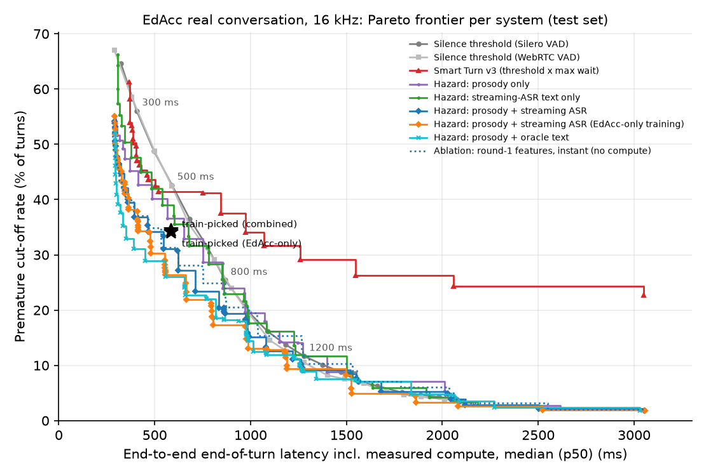
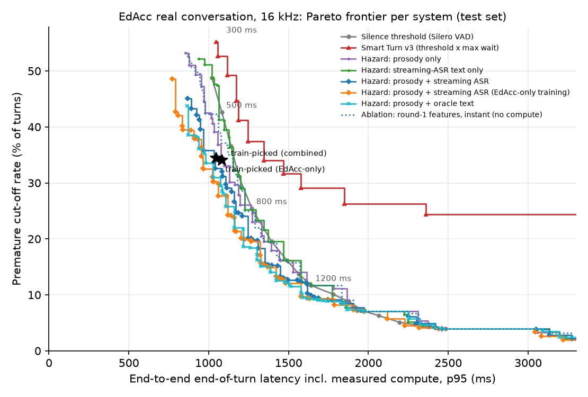

# eot-disfluency-bench

**A benchmark and a real-time baseline for end-of-turn detection when speakers pause,
use fillers, or speak English as a second language.**

Voice assistants have to decide, from a live audio stream, when the user has
finished speaking. The usual approach waits for a fixed amount of silence. People
who pause to think ("I'd like to book a table for... um... four people"), use
fillers, or speak English as a second language pause more often and for longer
inside their turns. A short silence threshold interrupts them; a long one makes
every reply slower. This repository measures that trade-off on real accented
conversation and tests whether a detector that also listens to *what* was said and
*how* it was said can do better **in real time**, with every millisecond of its own
compute counted.

Everything runs on a laptop (Apple M1 Max, 32 GB; MLX on its GPU, everything else
on CPU) and every number below comes from a run of this code on that machine.

**Headline (EdAcc real accented conversation, 1,609 test turns, 31 held-out
conversations; latency end to end, including measured compute).**

* The 500 ms silence baseline (Silero VAD) cuts off **42.6%** of turns at p50 590 /
  p95 1082 ms. The proposed real-time detector, with its operating point chosen on
  training data, cuts off **34.1%** (trained on EdAcc + synthetic) or **34.4%**
  (EdAcc only) at p50 586 ms: a paired reduction of **8.6 pp (95% CI 6.9 to 10.3)**
  and 8.3 pp (6.6 to 10.1).
* On p95 latency, the EdAcc-only model meets the goal (1048 vs 1082 ms). The
  combined model ties on the same 32 ms frame but is 0.003 ms slower, so by the
  stated criterion it does **not** meet it. The p95 differences have wide
  intervals (for the EdAcc-only model, -588 to +18 ms).
* The whole text path runs while the user is speaking. MLX Whisper decodes a 5 s
  window in 35 ms (median) on the M1 Max GPU, and the transcript covering a pause is
  ready 80 ms after the silence starts. The round-1 CPU pipeline measured about
  625 ms per decision. The real-time detector matches the earlier "instant
  features" version (35.0% at the same match point).
* The gain comes from a **confident hold**: wait past the usual maximum only while
  the model is confident the speaker is mid-turn. With a plain maximum wait and
  the same constraints, the best training setting is identical to the silence
  baseline.

## Why this problem

There are a small number of user reports that a voice mode ends the user's turn
mid-sentence (for example, a January 2026
[Let's Data Science news item](https://letsdatascience.com/news/claude-voice-mode-cuts-off-sentences-4cdeef16)
that summarises a single user's blog post, and a
[community issue tracker entry](https://claudeissues.com/issue/40940-voice-mode-latency-recording-inconsistency-and-random-interruptions)
that could not be retrieved when this was written). These are few, anecdotal, and
**not confirmed by the vendor**; this project does not claim that any product has
this problem. It treats premature end-of-turn as a general, well-known difficulty
of spoken dialogue systems and asks two questions that are useful regardless:

1. *How do we measure it?* Cut-offs are rare in logs and invisible in word error
   rate. They need ground truth for where a turn really ends, and they have to be
   reported together with latency (median *and* tail), because each can be
   optimised to a trivial extreme on its own.
2. *Can we lower it without making replies slower?* That is a streaming-latency
   question: every extra 100 ms of waiting is felt on every turn, and the model
   that decides must itself fit inside that budget.

For checking a real assistant by hand, see
[`docs/REPRO_PROTOCOL.md`](docs/REPRO_PROTOCOL.md): a scripted protocol with timed
pauses that involves no automated interaction with any product.

## The benchmark

| set | what it is | test turns |
|---|---|---:|
| **EdAcc (real)** | Turn-final segments from the Edinburgh International Accents of English Corpus: dyadic Zoom conversations, 41 L1 backgrounds, all 61 conversations (up to 60 turns each). A segment counts as a turn end only if the other speaker takes the floor next (not a backchannel). Turn end and intra-turn pauses come from an offline energy detector. | 1,609 (31 conversations, 62 speakers) |
| **Synthetic (TTS)** | 80 invented assistant-style requests spoken by 43 macOS voices, with a hesitation pause of 300 to 2000 ms inserted mid-clause or at a clause boundary, with or without a filler (`um`, `uh`, `so`, `and then`, `like`, `you know`). Exact ground truth by construction. | 480 (14 voices) |
| **Telephony** | 8 kHz copies of both test sets (300 to 3400 Hz band-pass, G.711-style mu-law). | 1,609 + 480 |

Training uses the other 1,611 EdAcc turns (30 conversations, 60 speakers) and
1,000 synthetic turns (29 voices). Splits are speaker-disjoint (EdAcc: by
conversation; synthetic: by voice) and the synthetic split is also
sentence-disjoint. Voices whose locale is not English reading English text are
labelled `tts_nonnative_approx`: **they only approximate non-native accents**.
EdAcc is the set that contains real L2 speech. Details, licences and sizes:
[`DATA.md`](DATA.md).

### Metrics

Each system fires once per turn (the moment it would hand the floor to the assistant).

* **Premature cut-off rate**: fraction of turns where the system fired before the
  true turn end, i.e. it would have interrupted the user.
* **End-to-end latency**: from the true end to the decision, **including the
  measured compute** of every model involved (VAD frames, ASR decodes, text and
  prosody features, the turn model itself). p50 and p95 over turns that were not
  cut off; a turn with no decision counts as infinite latency.
* **Late/miss rate**: no decision within 2 s of the true end.
* **95% confidence intervals** from a cluster bootstrap that resamples whole
  conversations (EdAcc) or voices (synthetic), 2,000 resamples; differences
  between systems use paired resamples of the same turns.
* **Trade-off curves**: cut-off rate against p50 and p95 latency, as a Pareto
  frontier over each system's settings, sliced by pause length, filler, accent
  group, clause type, real vs. synthetic and 16 vs. 8 kHz.

`tests/` pins down the metric definitions, the synthetic ground truth, the
streaming-ASR scheduler, feature availability, the firing rules, the bootstrap
and the EdAcc turn selection and split.

## Systems

All systems see the same causal 16 kHz stream (8 kHz copies are upsampled) and are
replayed frame by frame.

* **Silence threshold** (the common default): fire after *T* ms of non-speech,
  using Silero VAD v6 (32 ms frames, hysteresis 0.5/0.35) or WebRTC VAD
  (aggressiveness 3). *T* is swept from 200 to 2000 ms. The endpointer arms after
  250 ms of continuous speech.
* **Smart Turn v3** (`pipecat-ai/smart-turn-v3`, BSD-2-Clause, `v3.2-cpu` ONNX on
  CPU): an open audio model that predicts whether a turn is complete. Run in the
  style of its Pipecat integration with its reference preprocessing: after 200 ms
  of Silero silence the model scores the last 8 s of audio; fire if *p* > threshold,
  otherwise wait until a maximum wait (default 3 s). Threshold and maximum wait are
  swept, and also tuned on our training data.
* **Proposed: a real-time discrete-time hazard model** (`eotbench/hazard.py`,
  `eotbench/streaming.py`).
  * *Streaming text.* While the user speaks, MLX Whisper `base.en` re-transcribes
    the last 5 s every 0.5 s of new speech, and once more as soon as a silence
    starts. Each transcript becomes usable only after its **measured** decode and
    scoring time. At a pause only a cheap completeness score remains: trailing
    filler, conjunction, preposition, determiner or auxiliary; "and then"/"you
    know" endings; `distilgpt2`'s probability that a sentence ends next; and the
    transcript's age.
  * *Prosody and timing.* YIN F0 slope and final F0 relative to the speaker,
    energy decay, final lengthening and voicing over the last second (about 2 ms
    to compute), plus the pausing habit so far in this turn (number, mean and
    maximum of earlier pauses, time since the last one).
  * *Decision.* At every 32 ms frame of silence *d*, a gradient-boosted
    classifier (monotone in *d*) estimates P(turn ended | silence has lasted *d*,
    features available at that frame). Training rows come from every pause that
    *survived* to *d*. The model fires when P reaches *θ*. Otherwise it fires at a
    **maximum wait** *N*, unless it is confident the speaker is mid-turn
    (P ≤ *θ*<sub>hold</sub>), in which case it may keep waiting up to a **hard
    limit** *H*. The hold spends the latency budget only where the model expects
    more speech.
  * *Training.* On EdAcc-train + synthetic-train (combined), and on EdAcc-train
    alone as an ablation. Feature-set ablations: prosody only, streaming text
    only, oracle text (ground-truth words) and silence duration only. A further
    ablation reproduces the round-1 pipeline, whose features (12 s
    faster-whisper prefix on CPU, pYIN) were treated as **instant**; it is kept
    to show what ignoring compute would claim.

**Operating points are chosen on training data only.** For each domain, every
system's setting is the one with the lowest cut-off rate among those whose p50
*and* p95 end-to-end latency on the training split are no worse than the Silero
silence baseline at 500, 800 or 1200 ms. Hazard models are evaluated on
out-of-fold predictions grouped by conversation (EdAcc) or sentence (synthetic).
Smart Turn is tuned the same way. The test split is used once, for reporting. A
row labelled ORACLE in `results/RESULTS.md` picks its setting on the test set and
is shown only as a bound.

## Real-time feasibility: measured compute

Single stream, Apple M1 Max, measured on every call during the test-set runs
(training sets ran three streams at once; their medians are shown for comparison):

<!-- results:compute -->
| component | median ms (1 stream) | p95 ms (1 stream) | median ms (3 concurrent streams) | calls |
|---|---:|---:|---:|---:|
| Streaming ASR decode, MLX Whisper base.en, 5 s window (GPU) | 35.2 | 49.3 | 83.1 | 29986 |
| Text score: distilgpt2 end-of-sentence probability + rules (CPU) | 15.9 | 19.4 | 22.7 | 29986 |
| Fast prosody: YIN F0, energy, lengthening (CPU) | 2.0 | 2.2 | 2.9 | 5687 |
| Smart Turn v3 inference incl. features (CPU) | 26.5 | 27.0 | 37.9 | 5065 |
| Silero VAD, per 32 ms frame | 0.2 | 0.2 | 0.4 | 2089 |
| WebRTC VAD, per 30 ms frame | 0.0 | 0.0 | 0.0 | 2089 |
| Transcript covering the pause ready, after silence onset | 80.5 | 104.3 | 142.6 | 5686 |
| All hazard features ready, after silence onset (prosody runs at 160 ms) | 162.0 | 162.2 | 163.7 | 5686 |
| Hazard model evaluation, per 32 ms frame (CPU) | 13.67 | - | - | - |

Share of candidate pauses whose post-pause transcript was ready by the earliest decision (192 ms of silence): 99.8%. Mean decodes per test turn: 14.4.
<!-- /results:compute -->

At 35 ms per decode, re-transcribing every 0.5 s of speech occupies the GPU
decoder for about 7% of speaking time on one stream (14.4 decodes per test turn). When a
silence starts, the transcript that covers it arrives after a median of 80 ms,
before the earliest possible decision at 192 ms of silence in 99.8% of
candidate pauses. After that, a pause needs only a 16 ms text score, 2 ms of
prosody and one hazard evaluation per 32 ms frame. That evaluation is 13.7 ms
here, almost all of it scikit-learn's per-call overhead for a single row; a
compiled tree evaluator would be far cheaper, but the measured value is what the
latencies include. Smart Turn's measured 26.5 ms is added to its model-triggered
decisions in the same way. With three streams sharing the machine, decodes take
83 ms and the pause transcript arrives at 143 ms, still inside the 192 ms budget.

## Results

Test sets only; latency is end to end. Cells show the estimate and its 95%
cluster-bootstrap interval. Full tables (every system and match point, ablations,
slices, the ORACLE bound): [`results/RESULTS.md`](results/RESULTS.md); raw numbers
in `results/*.csv`.

### Goal check: real accented speech (EdAcc, 16 kHz)

Goal: fewer cut-offs than the 500 ms silence baseline at no more than its p50 *and*
p95 latency, with the operating point chosen on training data.

<!-- results:goal -->
* **Hazard: prosody + streaming ASR** (theta=0.98, max wait 500 ms, hold to 3000 ms while P<=0.05): cut-off 34.1% vs 42.6%, p50 586 vs 590 ms, p95 1082.174 vs 1082.171 ms; paired Δ cut-off -8.6 pp (95% CI -10.3 to -6.9): **not met**
* **Hazard: prosody + streaming ASR** (ablation: no hold) (theta=0.98, max wait 500 ms, no hold): cut-off 42.6% vs 42.6%, p50 590.164 vs 590.167 ms, p95 1082.171 vs 1082.171 ms; paired Δ cut-off +0.0 pp (95% CI +0.0 to +0.0): **not met**
* **Hazard: prosody + streaming ASR, EdAcc-only training** (theta=0.98, max wait 500 ms, hold to 3000 ms while P<=0.1): cut-off 34.4% vs 42.6%, p50 586 vs 590 ms, p95 1048 vs 1082 ms; paired Δ cut-off -8.3 pp (95% CI -10.1 to -6.6): **met**
* **Hazard: prosody + streaming ASR, EdAcc-only training** (ablation: no hold) (theta=0.98, max wait 500 ms, no hold): cut-off 42.6% vs 42.6%, p50 590.164 vs 590.167 ms, p95 1082.171 vs 1082.171 ms; paired Δ cut-off +0.0 pp (95% CI +0.0 to +0.0): **not met**
<!-- /results:goal -->

### EdAcc: real accented conversation, 16 kHz (1,609 turns, 31 conversations)

<!-- results:edacc_test_16k -->
| system | setting | cut-off | p50 latency, ms | p95 latency, ms | late/miss |
|---|---|---:|---:|---:|---:|
| Silence (Silero VAD) | 500 ms | 42.6% (37.2-48.3) | 590 (584-598) | 1082 (808-2068) | 1.9% (1.0-2.9) |
| Silence (Silero VAD) | 800 ms | 25.4% (20.1-31.1) | 868 (862-874) | 1270 (1078-1562) | 2.2% (1.1-3.4) |
| Silence (Silero VAD) | 1200 ms | 11.7% (8.1-15.5) | 1278 (1272-1284) | 1640 (1478-1908) | 2.7% (1.7-3.9) |
| Silence (WebRTC VAD) | 800 ms | 23.9% (18.4-30.0) | 900 (890-900) | inf (1880-inf) | 5.0% (3.3-6.8) |
| Smart Turn v3 | defaults: p>0.5, fallback 3000 ms | 43.6% (38.7-48.5) | 465 (414-874) | 3216 (3170-3544) | 25.0% (21.5-28.5) |
| Smart Turn v3 | p>0.95, max wait 500 ms [train-matched to Silero 500 ms] | 49.2% (43.7-55.0) | 564 (552-572) | 1116 (792-2068) | 1.7% (1.0-2.6) |
| Smart Turn v3 | p>0.95, max wait 800 ms [train-matched to Silero 800 ms] | 37.5% (32.0-43.2) | 844 (834-852) | 1244 (1044-1562) | 1.8% (1.0-2.7) |
| Ablation: round-1 features, instant | theta=0.97, max wait 500 ms, hold to 2000 ms while P<=0.02 [train-matched to Silero 500 ms] | 35.0% (30.4-39.7) | 584 (576-590) | 1048 (798-1468) | 2.0% (1.1-3.0) |
| **Hazard: prosody + streaming ASR** | theta=0.98, max wait 500 ms, hold to 3000 ms while P<=0.05 [train-matched to Silero 500 ms] | 34.1% (29.5-38.8) | 586 (578-592) | 1082 (842-1652) | 2.1% (1.3-3.1) |
| **Hazard: prosody + streaming ASR** | theta=0.99, max wait 800 ms, hold to 3000 ms while P<=0.05 [train-matched to Silero 800 ms] | 19.8% (15.6-24.2) | 864 (858-872) | 1324 (1086-1520) | 2.4% (1.4-3.5) |
| **Hazard: prosody + streaming ASR** | theta=0.99, max wait 1200 ms, hold to 3000 ms while P<=0.1 [train-matched to Silero 1200 ms] | 9.3% (6.4-12.4) | 1276 (1270-1282) | 1710 (1494-1934) | 3.1% (2.0-4.3) |
| **Hazard: prosody + streaming ASR** | theta=0.98, max wait 500 ms, no hold [train-matched to Silero 500 ms] (ablation: max wait only, no hold) | 42.6% (37.2-48.3) | 590 (584-596) | 1082 (808-2068) | 1.9% (1.0-2.9) |
| **Hazard: prosody + streaming ASR, EdAcc-only training** | theta=0.98, max wait 500 ms, hold to 3000 ms while P<=0.1 [train-matched to Silero 500 ms] | 34.4% (29.8-39.1) | 586 (578-592) | 1048 (800-1318) | 1.9% (1.0-2.9) |
| **Hazard: prosody + streaming ASR, EdAcc-only training** | theta=0.99, max wait 800 ms, hold to 3000 ms while P<=0.1 [train-matched to Silero 800 ms] | 20.0% (15.8-24.3) | 864 (858-870) | 1266 (1078-1518) | 2.2% (1.1-3.4) |
| Hazard: prosody + oracle text | theta=0.98, max wait 500 ms, hold to 3000 ms while P<=0.02 [train-matched to Silero 500 ms] | 33.3% (28.8-38.1) | 584 (576-590) | 1042 (798-1318) | 1.9% (1.0-2.9) |
<!-- /results:edacc_test_16k -->

Paired differences against the matched Silero baseline (negative = better):

<!-- results:deltas_edacc_test_16k -->
| system | setting | vs | Δ cut-off (pp) | Δ p50 (ms) | Δ p95 (ms) |
|---|---|---|---:|---:|---:|
| Smart Turn v3 | p>0.95, max wait 500 ms | Silero 500 ms | +6.6 (+5.2 to +8.1) | -26 (-38 to -18) | +34 (-182 to +324) |
| Smart Turn v3 | p>0.95, max wait 800 ms | Silero 800 ms | +12.1 (+10.1 to +14.1) | -24 (-36 to -16) | -26 (-160 to +122) |
| Smart Turn v3 | p>0.95, max wait 1200 ms | Silero 1200 ms | +17.4 (+14.9 to +20.1) | -18 (-30 to -12) | -64 (-163 to +58) |
| **Hazard: prosody + streaming ASR** | theta=0.98, max wait 500 ms, hold to 3000 ms while P<=0.05 | Silero 500 ms | -8.6 (-10.3 to -6.9) | -4 (-8 to -2) | +0 (-446 to +98) |
| **Hazard: prosody + streaming ASR** | theta=0.99, max wait 800 ms, hold to 3000 ms while P<=0.05 | Silero 800 ms | -5.7 (-7.6 to -4.0) | -4 (-6 to -2) | +54 (-86 to +122) |
| **Hazard: prosody + streaming ASR** | theta=0.99, max wait 1200 ms, hold to 3000 ms while P<=0.1 | Silero 1200 ms | -2.4 (-3.5 to -1.4) | -2 (-4 to -0) | +70 (+2 to +140) |
| **Hazard: prosody + streaming ASR, EdAcc-only training** | theta=0.98, max wait 500 ms, hold to 3000 ms while P<=0.1 | Silero 500 ms | -8.3 (-10.1 to -6.6) | -4 (-8 to -2) | -34 (-588 to +18) |
| **Hazard: prosody + streaming ASR, EdAcc-only training** | theta=0.99, max wait 800 ms, hold to 3000 ms while P<=0.1 | Silero 800 ms | -5.5 (-7.5 to -3.7) | -4 (-6 to -2) | -4 (-114 to +44) |
| **Hazard: prosody + streaming ASR, EdAcc-only training** | theta=0.995, max wait 1200 ms, hold to 3000 ms while P<=0.1 | Silero 1200 ms | -2.3 (-3.4 to -1.3) | -2 (-4 to -0) | +42 (-34 to +74) |
<!-- /results:deltas_edacc_test_16k -->




### Synthetic TTS, 16 kHz (480 turns, 14 held-out voices, 24 held-out sentences)

<!-- results:synth_test_16k -->
| system | setting | cut-off | p50 latency, ms | p95 latency, ms | late/miss |
|---|---|---:|---:|---:|---:|
| Silence (Silero VAD) | 500 ms | 59.4% (54.5-62.5) | 572 (566-580) | 614 (600-618) | 0.0% (0.0-0.0) |
| Silence (Silero VAD) | 800 ms | 46.5% (40.4-50.8) | 856 (852-868) | 902 (888-906) | 0.0% (0.0-0.0) |
| Silence (Silero VAD) | 1200 ms | 30.8% (26.9-33.4) | 1274 (1266-1284) | 1314 (1304-1322) | 0.0% (0.0-0.0) |
| Silence (WebRTC VAD) | 800 ms | 48.3% (41.8-52.4) | 870 (860-880) | 910 (900-920) | 0.0% (0.0-0.0) |
| Smart Turn v3 | defaults: p>0.5, fallback 3000 ms | 70.8% (59.9-77.5) | 320 (310-343) | 3100 (3066-3114) | 7.1% (2.9-15.3) |
| Smart Turn v3 | p>0.95, max wait 500 ms [train-matched to Silero 500 ms] | 73.8% (67.0-77.4) | 363 (327-568) | 604 (578-618) | 0.0% (0.0-0.0) |
| Smart Turn v3 | p>0.95, max wait 800 ms [train-matched to Silero 800 ms] | 69.8% (59.7-74.8) | 814 (329-856) | 896 (866-906) | 0.0% (0.0-0.0) |
| Ablation: round-1 features, instant | theta=0.55, max wait 3000 ms, no hold [train-matched to Silero 500 ms] | 17.9% (13.3-25.9) | 254 (248-262) | 750 (480-970) | 1.0% (0.0-1.6) |
| **Hazard: prosody + streaming ASR** | theta=0.65, max wait 3000 ms, no hold [train-matched to Silero 500 ms] | 13.8% (9.5-21.5) | 267 (261-279) | 887 (649-1171) | 1.2% (0.0-2.0) |
| **Hazard: prosody + streaming ASR** | theta=0.75, max wait 3000 ms, no hold [train-matched to Silero 800 ms] | 10.2% (6.4-17.2) | 273 (265-293) | 1213 (893-1623) | 1.7% (0.3-2.5) |
| **Hazard: prosody + streaming ASR** | theta=0.85, max wait 3000 ms, no hold [train-matched to Silero 1200 ms] | 5.6% (3.1-10.1) | 291 (275-383) | 1675 (1289-2009) | 3.3% (1.7-5.0) |
| **Hazard: prosody + streaming ASR** | theta=0.65, max wait 3000 ms, no hold [train-matched to Silero 500 ms] (ablation: max wait only, no hold) | 13.8% (9.5-21.5) | 267 (261-279) | 887 (649-1171) | 1.2% (0.0-2.0) |
| Hazard: prosody + oracle text | theta=0.8, max wait 3000 ms, no hold [train-matched to Silero 500 ms] | 5.8% (3.6-9.7) | 267 (261-277) | 835 (767-857) | 0.0% (0.0-0.0) |
<!-- /results:synth_test_16k -->

### Telephony (8 kHz), both test sets

<details><summary>EdAcc, 8 kHz</summary>

<!-- results:edacc_test_8k -->
| system | setting | cut-off | p50 latency, ms | p95 latency, ms | late/miss |
|---|---|---:|---:|---:|---:|
| Silence (Silero VAD) | 500 ms | 46.9% (42.2-51.7) | 578 (570-586) | 750 (706-870) | 1.1% (0.6-1.7) |
| Silence (Silero VAD) | 800 ms | 29.3% (23.7-35.3) | 856 (850-862) | 1008 (972-1084) | 1.4% (0.7-2.1) |
| Silence (Silero VAD) | 1200 ms | 14.4% (10.5-18.5) | 1268 (1264-1274) | 1408 (1376-1454) | 1.7% (0.9-2.7) |
| Silence (WebRTC VAD) | 800 ms | 28.6% (22.6-34.7) | 860 (840-870) | 930 (930-1500) | 2.3% (1.3-3.4) |
| Smart Turn v3 | defaults: p>0.5, fallback 3000 ms | 48.7% (44.1-53.5) | 435 (391-515) | 3150 (3130-3196) | 22.7% (19.3-26.2) |
| Smart Turn v3 | p>0.95, max wait 500 ms [train-matched to Silero 500 ms] | 53.4% (48.6-58.1) | 550 (534-562) | 750 (698-976) | 1.1% (0.6-1.6) |
| Smart Turn v3 | p>0.95, max wait 800 ms [train-matched to Silero 800 ms] | 41.8% (36.1-47.6) | 834 (822-844) | 1000 (968-1106) | 1.3% (0.7-2.0) |
| **Hazard: prosody + streaming ASR** | theta=0.98, max wait 500 ms, hold to 3000 ms while P<=0.05 [train-matched to Silero 500 ms] | 37.8% (33.8-41.8) | 572 (566-582) | 788 (714-1100) | 1.5% (0.9-2.2) |
| **Hazard: prosody + streaming ASR** | theta=0.99, max wait 800 ms, hold to 3000 ms while P<=0.05 [train-matched to Silero 800 ms] | 22.9% (18.4-27.7) | 856 (850-860) | 1032 (986-1158) | 1.7% (1.0-2.6) |
| **Hazard: prosody + streaming ASR** | theta=0.99, max wait 1200 ms, hold to 3000 ms while P<=0.1 [train-matched to Silero 1200 ms] | 10.9% (7.9-14.1) | 1268 (1262-1274) | 1418 (1386-1508) | 2.1% (1.2-3.1) |
| **Hazard: prosody + streaming ASR** | theta=0.98, max wait 500 ms, no hold [train-matched to Silero 500 ms] (ablation: max wait only, no hold) | 46.9% (42.2-51.7) | 578 (570-586) | 750 (706-870) | 1.1% (0.6-1.7) |
| **Hazard: prosody + streaming ASR, EdAcc-only training** | theta=0.98, max wait 500 ms, hold to 3000 ms while P<=0.1 [train-matched to Silero 500 ms] | 38.4% (34.2-42.4) | 572 (566-582) | 756 (708-886) | 1.3% (0.7-1.9) |
| **Hazard: prosody + streaming ASR, EdAcc-only training** | theta=0.99, max wait 800 ms, hold to 3000 ms while P<=0.1 [train-matched to Silero 800 ms] | 23.3% (18.7-28.0) | 856 (850-860) | 1010 (974-1092) | 1.6% (0.8-2.4) |
| Hazard: prosody + oracle text | theta=0.98, max wait 500 ms, hold to 3000 ms while P<=0.02 [train-matched to Silero 500 ms] | 37.3% (33.3-41.3) | 570 (564-578) | 744 (702-850) | 1.2% (0.6-1.8) |
<!-- /results:edacc_test_8k -->

</details>

<details><summary>Synthetic, 8 kHz</summary>

<!-- results:synth_test_8k -->
| system | setting | cut-off | p50 latency, ms | p95 latency, ms | late/miss |
|---|---|---:|---:|---:|---:|
| Silence (Silero VAD) | 500 ms | 61.0% (55.9-65.5) | 571 (562-586) | 618 (604-636) | 0.0% (0.0-0.0) |
| Silence (Silero VAD) | 800 ms | 48.1% (42.4-52.8) | 856 (850-870) | 906 (896-924) | 0.0% (0.0-0.0) |
| Silence (Silero VAD) | 1200 ms | 31.9% (27.9-35.1) | 1272 (1264-1284) | 1322 (1306-1340) | 0.0% (0.0-0.0) |
| Silence (WebRTC VAD) | 800 ms | 53.8% (47.6-57.3) | 810 (800-840) | 890 (870-inf) | 0.6% (0.0-2.5) |
| Smart Turn v3 | defaults: p>0.5, fallback 3000 ms | 66.0% (50.6-74.5) | 347 (327-3042) | 3114 (3074-3134) | 13.3% (5.7-28.3) |
| Smart Turn v3 | p>0.95, max wait 500 ms [train-matched to Silero 500 ms] | 70.8% (64.9-75.6) | 381 (333-558) | 616 (580-622) | 0.0% (0.0-0.0) |
| Smart Turn v3 | p>0.95, max wait 800 ms [train-matched to Silero 800 ms] | 64.8% (56.4-70.2) | 810 (341-859) | 906 (872-924) | 0.0% (0.0-0.0) |
| **Hazard: prosody + streaming ASR** | theta=0.65, max wait 3000 ms, no hold [train-matched to Silero 500 ms] | 21.2% (16.9-29.8) | 269 (259-285) | 1031 (823-1121) | 0.6% (0.0-1.2) |
| **Hazard: prosody + streaming ASR** | theta=0.75, max wait 3000 ms, no hold [train-matched to Silero 800 ms] | 15.4% (11.8-22.2) | 275 (265-303) | 1305 (1067-1415) | 1.0% (0.0-2.1) |
| **Hazard: prosody + streaming ASR** | theta=0.85, max wait 3000 ms, no hold [train-matched to Silero 1200 ms] | 9.6% (6.9-14.1) | 323 (287-513) | 1677 (1379-1735) | 2.7% (1.2-3.7) |
| **Hazard: prosody + streaming ASR** | theta=0.65, max wait 3000 ms, no hold [train-matched to Silero 500 ms] (ablation: max wait only, no hold) | 21.2% (16.9-29.8) | 269 (259-285) | 1031 (823-1121) | 0.6% (0.0-1.2) |
| Hazard: prosody + oracle text | theta=0.8, max wait 3000 ms, no hold [train-matched to Silero 500 ms] | 6.2% (4.1-10.0) | 273 (261-285) | 895 (765-961) | 0.0% (0.0-0.0) |
<!-- /results:synth_test_8k -->

</details>

### What the results say

* **The goal is met on real speech by the EdAcc-only model, and missed by
  0.003 ms by the combined model.** Both cut off about 8.5 pp fewer turns than
  the 500 ms silence baseline at a 4 ms lower median. The cut-off reduction is
  clearly outside noise (paired 95% CIs exclude zero). The p95 equality is a
  point estimate: the baseline's own p95 interval spans 808 to 2068 ms because a
  few conversations have long VAD lags.
* **The tail constraint does not always transfer from training to test.**
  Matched to the 800 ms and 1200 ms baselines on training data, the combined
  model still lowers cut-offs (19.8% vs 25.4%; 9.3% vs 11.7%). Its test p95,
  however, is 54 ms and 70 ms higher, and for 1200 ms the interval (+2 to +140 ms)
  excludes zero. The EdAcc-only model stays within 4 ms at 800 ms
  (1266 vs 1270 ms).
* **The confident hold is what makes the difference.** A plain maximum wait has
  to stay near 500 ms to protect p95, so it cannot wait out long mid-turn pauses.
  The hold extends the wait to as much as 3 s only while P(end) ≤ 0.05 to 0.1.
  This spends the 5% tail budget almost entirely on pauses that really are
  mid-turn. Without the hold, the best training setting reproduces the baseline
  exactly (42.6%).
* **Where it helps.** Against Silero 500 ms on EdAcc: turns whose longest pause
  is 150 to 500 ms drop from 14.5% to 9.0% cut off, 0.5 to 1 s pauses from 86.9% to
  70.7%, 1 to 2 s from 94.3% to 78.7%. Turns with fillers drop from 59.0% to 51.0%,
  without fillers from 34.1% to 25.2%. L2-English speakers drop from 43.2% to
  34.6% and L1-English speakers from 41.8% to 33.3%. Long pauses remain the hard
  case: most turns with a 1 to 2 s pause are still cut off (78.7%).
* **Streaming ASR is now close to oracle text on real speech** (34.1% vs 33.3% with
  ground-truth words at the 500 ms match), and the real-time pipeline is no worse
  than the round-1 pipeline that ignored compute (35.0%). Measuring compute
  honestly cost nothing here, because the decode fits inside the first 192 ms of
  every pause.
* **Smart Turn v3 is not a drop-in fix for this population.** With defaults it
  cut off 43.6% of EdAcc turns and waited the full 3 s fallback on many others
  (25.0% late). Tuned on our training data, it was worse than silence at matched
  latency (+6.6 pp at 500 ms, +12.1 pp at 800 ms). It was trained on different
  data and is used here outside its design conditions (long hesitations, room tone
  after the turn, TTS speech), so this says more about domain fit than about the
  model.
* **Synthetic speech is easier but less faithful.** The detector cuts off 13.8% vs
  59.4% at a median of 267 vs 572 ms. However, the p95 chosen on training was
  exceeded on the sentence- and voice-disjoint test set (887 vs 614 ms). The
  clause-boundary items, where the prefix is already a complete sentence, remain
  hardest (27.7% vs 11.6% mid-clause).
* **Telephony.** At 8 kHz the detector still lowers EdAcc cut-offs (37.8% vs 46.9%
  at p50 572 vs 578 ms). Its p95 is higher, though (788 vs 750 ms; 756 ms for the
  EdAcc-only model), so the goal is not met on the 8 kHz channel. The models were
  trained on 16 kHz audio only.

## Limitations

* **EdAcc ground truth is approximate.** Turn ends come from segment order and an
  energy detector, not from human timing annotation. Breaths and partner crosstalk
  can move them by tens of milliseconds. The 4 s after each turn is the speaker's
  own room tone; in the real conversation the partner spoke there.
* **Real time is simulated with measured costs.** Audio is replayed from disk and
  every model call is timed on this machine. The schedule is simulated: a single
  decoder worker, with costs added rather than overlapped with capture, and no
  network or device jitter. Headline timings are single-stream; with three
  concurrent streams decodes roughly double.
* **Development history.** The confident hold was added during this round, after
  the plain maximum wait failed to beat the baseline on *training* out-of-fold
  predictions. It was designed and tuned on training data only. However, round 1
  of this project reported results on an earlier, smaller EdAcc split, and some of
  those conversations are in today's test split. The test set is therefore not
  untouched by the project's overall history.
* **Clusters are few.** 31 test conversations and 14 test voices bound how precise
  any interval can be, especially for p95.
* **The synthetic set is easy for text and prosody** (one inserted pause,
  continuation intonation from TTS, templated sentences), and its out-of-fold
  selection is optimistic. TTS "accents" are not L2 speech. One legacy voice
  ("Albert", training split only) is never detected as speech by Silero.
* **Single-fire evaluation.** A real system that interrupts can recover; here
  one premature decision counts as a cut-off. Backchannels, barge-in and
  overlapping speech are out of scope.

## Connection to turn-taking research

Conversation analysis describes turns as built from units whose possible
completion points are projectable from syntax, prosody and action, not from
silence alone (Sacks, Schegloff & Jefferson, 1974). Across languages the typical
gap between turns is about 200 ms, shorter than the time needed to plan a reply,
so listeners must predict ends before they happen (Stivers et al., 2009). Pauses
inside a turn are often *longer* than gaps between turns (Heldner & Edlund, 2010).
That is exactly why a silence threshold cannot separate the two, and why it
hurts most for speakers who pause more mid-clause, as second-language speakers
typically do (Kormos, 2006). Turn-yielding cues documented in human dialogue
(final pitch fall or rise, final lengthening, intensity drop, syntactic
completion; Gravano & Hirschberg, 2011) motivate the feature set here. Treating
the decision as a cost-sensitive choice made repeatedly during silence follows
Raux & Eskenazi (2009). The confident hold mirrors how listeners treat a
hesitation they can tell is mid-utterance. Continuous predictive models such as
TurnGPT and Voice Activity Projection (Ekstedt & Skantze, 2020, 2022) and the
review by Skantze (2021) point to where this baseline should go next: a model that
predicts upcoming speech activity from audio and text jointly, evaluated on
benchmarks like this one that report cut-offs, median and tail latency, and the
model's own compute.

* Ekstedt, E., & Skantze, G. (2020). TurnGPT: a Transformer-based language model for predicting turn-taking in spoken dialog. *Findings of EMNLP*.
* Ekstedt, E., & Skantze, G. (2022). Voice Activity Projection: Self-supervised learning of turn-taking events. *Interspeech*.
* Gravano, A., & Hirschberg, J. (2011). Turn-taking cues in task-oriented dialogue. *Computer Speech & Language*, 25(3).
* Heldner, M., & Edlund, J. (2010). Pauses, gaps and overlaps in conversations. *Journal of Phonetics*, 38(4).
* Kormos, J. (2006). *Speech Production and Second Language Acquisition*. Lawrence Erlbaum.
* Raux, A., & Eskenazi, M. (2009). A finite-state turn-taking model for spoken dialog systems. *NAACL-HLT*.
* Sacks, H., Schegloff, E. A., & Jefferson, G. (1974). A simplest systematics for the organization of turn-taking for conversation. *Language*, 50(4).
* Sanabria, R., et al. (2023). The Edinburgh International Accents of English Corpus: Towards the democratization of English ASR. *ICASSP*.
* Skantze, G. (2021). Turn-taking in conversational systems and human-robot interaction: A review. *Computer Speech & Language*, 67.
* Stivers, T., et al. (2009). Universals and cultural variation in turn-taking in conversation. *PNAS*, 106(26).

## Reproduce

Requirements: macOS on Apple silicon (for `say` and MLX), Python 3.11, about 10 GB
of disk (EdAcc download 6.95 GB), no NVIDIA GPU, no paid APIs.

```bash
make venv      # .venv + pinned requirements
make data      # synthetic set + full EdAcc download, turn selection, word alignment
make train     # real-time extraction (test sets single-stream), instant ablation, training
make bench     # replay all systems, choose operating points on train, bootstrap CIs
make report    # results/RESULTS.md, results/plots/, README tables
make test      # pytest
```

Wall-clock times of the run behind these results: synthetic generation 16 min;
EdAcc download about 3 min, turn selection 1 min, word alignment 15 min; real-time
extraction 64 min for the test sets (single stream) and 26 min for the training
sets (three streams); instant-feature ablation 44 min; training 10 min; bench
about 15 min. In total, about 3.3 hours.

## Layout

```
eotbench/
  audio.py       I/O, resampling, noise, telephony channel
  sentences.py   invented sentence bank with split points
  synth.py       synthetic generator with exact ground truth
  edacc.py       EdAcc download, turn selection (cap per conversation), labels, split, alignment
  vad.py         Silero / WebRTC frames, arming, silence runs
  streaming.py   event-driven streaming-ASR schedule with measured costs
  features.py    text completeness, LM, prosody (pYIN and fast YIN), pausing habit, ASR
  hazard.py      discrete-time hazard model with availability-aware features
  systems.py     silence, Smart Turn and hazard firing rules (max wait, confident hold)
  metrics.py     cut-off, latency, late/miss, cluster and paired bootstrap
scripts/         prepare_data, extract, train, bench, report
tests/           pytest suite
docs/REPRO_PROTOCOL.md   manual protocol for checking a voice assistant
results/         CSVs, RESULTS.md, plots (generated)
```

## License

Code: MIT, © 2026 Gabriel Velázquez (see `LICENSE`). Data is not redistributed;
EdAcc is CC BY-SA 4.0 and the third-party models keep their own licences (see
`DATA.md`).
