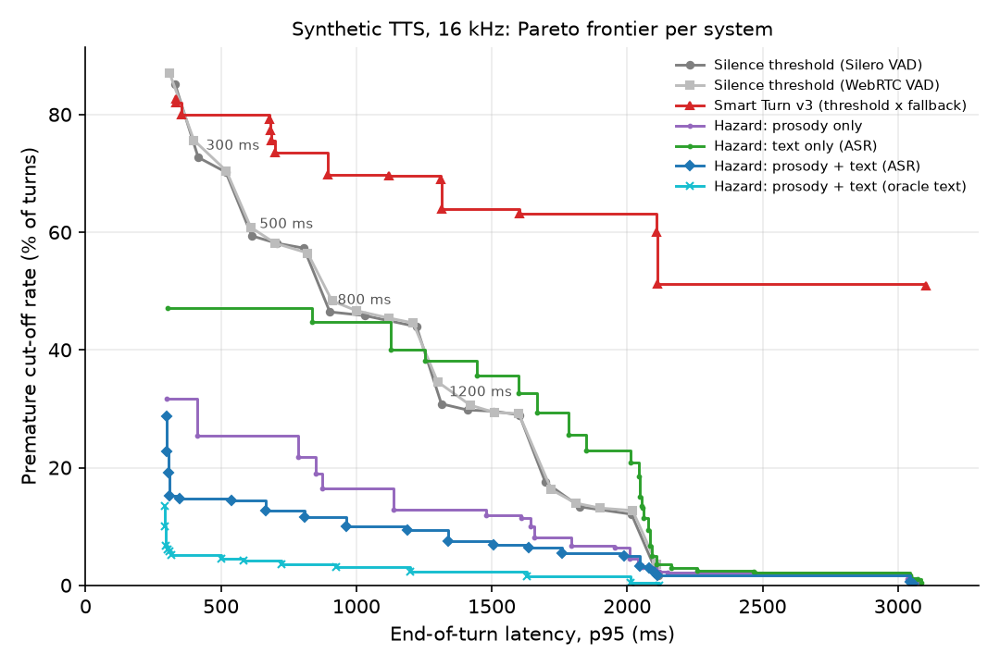

# eot-disfluency-bench

**A benchmark and a baseline study of end-of-turn detection for speakers who pause,
use fillers, or speak English as a second language.**

Voice assistants have to decide, from a live audio stream, when the user has
finished speaking. The usual approach waits for a fixed amount of silence. People
who pause to think ("I'd like to book a table for... um... four people"), use
fillers, or speak English as a second language pause more often and for longer
inside their turns. A short silence threshold interrupts them; a long one makes
every reply slower. This repository measures that trade-off and tests whether a
detector that also listens to *what* was said and *how* it was said can do better.

Everything here is reproducible on a laptop (Apple M1 Max, CPU only) with one
command, and every number below comes from a run of this code on that machine.

## Why this problem

There are a small number of user reports that a voice mode ends the user's turn
mid-sentence (for example, a January 2026
[Let's Data Science news item](https://letsdatascience.com/news/claude-voice-mode-cuts-off-sentences-4cdeef16)
that summarises a single user's blog post, and a
[community issue tracker entry](https://claudeissues.com/issue/40940-voice-mode-latency-recording-inconsistency-and-random-interruptions)
that could not be retrieved when this was written). These are few, anecdotal, and
**not confirmed by the vendor**; this project does not claim that any product has
this problem. It treats premature end-of-turn as a general, well-known difficulty
of spoken dialogue systems and asks two questions that are useful regardless:

1. *How do we measure it?* Cut-offs are rare in logs and invisible in word error
   rate. They need ground truth for where a turn really ends, and they need to be
   reported together with latency, because either one alone can be optimised to a
   trivial extreme.
2. *Can we lower it without making replies slower?* That is a streaming-latency
   question: every extra 100 ms of waiting is felt on every turn.

For checking a real assistant by hand, see
[`docs/REPRO_PROTOCOL.md`](docs/REPRO_PROTOCOL.md): a scripted protocol with timed
pauses that involves no automated interaction with any product.

## The benchmark

| set | what it is | test items |
|---|---|---:|
| **EdAcc (real)** | Turn-final segments from the Edinburgh International Accents of English Corpus: dyadic Zoom conversations, 21 L1 backgrounds. A segment counts as a turn end only if the other speaker takes the floor next (not a backchannel). Turn end and intra-turn pauses come from an offline energy detector. | 250 (18 speakers) |
| **Synthetic (TTS)** | 80 invented assistant-style requests spoken by 43 macOS voices, with a hesitation pause of 300 to 2000 ms inserted mid-clause or at a clause boundary, with or without a filler (`um`, `uh`, `so`, `and then`, `like`, `you know`). Exact ground truth by construction. | 480 (14 voices) |
| **Telephony** | 8 kHz copies of both test sets (300 to 3400 Hz band-pass, G.711-style mu-law). | 250 + 480 |

Splits are speaker-disjoint (EdAcc: by conversation; synthetic: by voice) and the
synthetic split is also sentence-disjoint. Voices whose locale is not English
reading English text are labelled `tts_nonnative_approx`: **they only
approximate non-native accents**. EdAcc is the set that contains real L2 speech.
Details, licences and sizes are in [`DATA.md`](DATA.md).

### Metrics

Each system fires once per turn (the moment it would hand the floor to the assistant).

* **Premature cut-off rate**: fraction of turns where the system fired before the
  true turn end, i.e. it would have interrupted the user.
* **End-of-turn latency**: time from the true end to the fire, p50 and p95, over
  turns that were not cut off. A turn with no fire counts as infinite latency.
* **Late/miss rate**: no fire within 2 s of the true end.
* **Trade-off curves**: cut-off rate against p50 and against p95 latency, as a
  Pareto frontier over each system's settings, sliced by pause length, filler,
  accent group, clause type, real vs. synthetic and 16 vs. 8 kHz.

`tests/test_metrics.py` pins these definitions down; `tests/test_synth.py`
checks the synthetic ground truth (inserted pause length, turn end, telephony copy).

## Systems

All systems see the same causal audio stream and are replayed frame by frame.

* **Silence threshold** (the common default): fire after *T* ms of non-speech,
  using Silero VAD v6 (32 ms frames, hysteresis 0.5/0.35) or WebRTC VAD
  (aggressiveness 3). *T* is swept from 200 to 2000 ms. The endpointer arms after
  250 ms of continuous speech.
* **Smart Turn v3** (`pipecat-ai/smart-turn-v3`, BSD-2-Clause, `v3.2-cpu` ONNX on
  CPU): an open audio model that predicts whether a turn is complete. Run in the
  style of its Pipecat integration, with its reference preprocessing: after 200 ms of Silero silence the model is run on the
  last 8 s of audio; fire if *p* > threshold, otherwise wait for a fallback
  timeout (default 3 s). Thresholds and fallbacks are swept.
* **Proposed: a discrete-time hazard model** (`eotbench/hazard.py`). When a
  silence reaches 160 ms, it computes features once:
  * *text*: the transcript so far, either from faster-whisper `base.en` run on the
    audio prefix (the realistic setting) or from ground-truth words (an oracle
    ablation): trailing filler, conjunction, preposition, determiner or
    auxiliary; "and then"/"you know" endings; and the probability of a
    sentence end next under `distilgpt2`;
  * *prosody*: F0 slope over the last 300 ms of voicing and final F0 relative to
    the turn (pYIN), energy decay over the last 200 ms, final-syllable
    lengthening (last voiced run vs. typical), voicing fraction, turn duration;

  and then, for every further VAD frame of silence *d*, estimates
  P(turn ended | silence has lasted *d*, features) with a gradient-boosted
  classifier (monotone in *d*). Training rows come from every pause that
  *survived* to *d*, so the model learns how fast accumulating silence should
  override the other cues. It fires at the first frame where the probability
  reaches *θ*, or when the silence reaches a cap. This lets it fire early on
  confident ends and keep waiting on pauses that look mid-turn. Variants:
  prosody only, text only (ASR / oracle), fusion (ASR / oracle), and duration
  only (a learned silence threshold, as a sanity check).

**Operating points are chosen on training data only.** For each domain, the
setting with the lowest cut-off rate is picked among those whose p50 *and* p95
latency on the training split (out-of-fold, grouped by speaker, for the hazard
models) are no worse than the Silero silence baseline at 500, 800 or 1200 ms.
The same procedure tunes Smart Turn's threshold and fallback.

## Results

Test sets only. Full tables (every system and match point, all slices):
[`results/RESULTS.md`](results/RESULTS.md); raw numbers in `results/*.csv`.

### EdAcc: real accented conversation, 16 kHz (250 turns, 18 speakers)

| system | setting | cut-off | p50 ms | p95 ms | late/miss |
|---|---|---:|---:|---:|---:|
| Silence 500 ms (Silero) | 500 ms | 48.0% | 606 | 1468 | 2.0% |
| Silence 800 ms (Silero) | 800 ms | 30.4% | 872 | 1520 | 2.4% |
| Silence 1200 ms (Silero) | 1200 ms | 19.2% | 1280 | 1720 | 3.2% |
| Silence 800 ms (WebRTC) | 800 ms | 30.8% | 890 | inf | 6.4% |
| Smart Turn v3, defaults | p>0.5, fallback 3000 ms | 46.0% | 536 | 3290 | 24.4% |
| Smart Turn v3, tuned on train (match 800) | p>0.95, fallback 800 ms | 42.8% | 818 | 1368 | 2.0% |
| **Hazard, prosody + ASR text (match 500)** | θ=0.5, cap 2000 ms | **40.0%** | **460** | 2268 | 10.8% |
| **Hazard, prosody + ASR text (match 800)** | θ=0.55, cap 2000 ms | 37.6% | 568 | 2268 | 12.4% |
| Hazard, prosody + oracle text (match 800) | θ=0.7, cap 2000 ms | 28.8% | 488 | 2164 | 9.6% |
| Hazard, prosody only (match 800) | θ=0.65, cap 2000 ms | 36.8% | 746 | 2422 | 14.4% |
| Hazard, ASR text only (match 800) | θ=0.45, cap 2000 ms | 41.2% | 504 | 2148 | 6.8% |


### Synthetic TTS, 16 kHz (480 turns, 14 held-out voices, 24 held-out sentences)

| system | setting | cut-off | p50 ms | p95 ms | late/miss |
|---|---|---:|---:|---:|---:|
| Silence 500 ms (Silero) | 500 ms | 59.4% | 572 | 614 | 0.0% |
| Silence 800 ms (Silero) | 800 ms | 46.5% | 856 | 902 | 0.0% |
| Silence 1200 ms (Silero) | 1200 ms | 30.8% | 1274 | 1314 | 0.0% |
| Silence 800 ms (WebRTC) | 800 ms | 48.3% | 870 | 910 | 0.0% |
| Smart Turn v3, defaults | p>0.5, fallback 3000 ms | 70.8% | 294 | 3100 | 7.1% |
| Smart Turn v3, tuned on train (match 800) | p>0.95, fallback 800 ms | 69.8% | 814 | 896 | 0.0% |
| **Hazard, prosody + ASR text (match 500)** | θ=0.7, cap 3000 ms | **6.5%** | **254** | 1636 | 3.3% |
| **Hazard, prosody + ASR text (match 800)** | θ=0.8, cap 3000 ms | 5.0% | 256 | 1988 | 4.6% |
| Hazard, prosody + oracle text (match 800) | θ=0.97, cap 3000 ms | 0.4% | 260 | 2014 | 5.0% |
| Hazard, prosody only (match 800) | θ=0.5, cap 3000 ms | 10.0% | 254 | 1642 | 3.8% |
| Hazard, ASR text only (match 800) | θ=0.55, cap 3000 ms | 18.1% | 260 | 2052 | 5.0% |



8 kHz telephony results follow the same pattern (EdAcc: Silero 800 ms 33.6%
cut-off, p50 858 / p95 1084 ms; hazard fusion-ASR matched to 500 ms 42.8%,
p50 456 / p95 2180 ms; synthetic: hazard fusion-ASR matched to 800 ms 7.1% vs.
Silero 800 ms 48.1%). See `results/RESULTS.md` and `results/plots/`.

### What the results say

* **Did the proposed detector beat the silence baselines?** *Partly; not on the
  strict criterion.* On real accented conversation (EdAcc) the train-selected
  fusion model has a lower cut-off rate **and** a lower median latency than the
  500 ms silence baseline (40.0% vs. 48.0%; 460 vs. 606 ms). It pays for this in
  the tail: p95 latency is 2268 vs. 1468 ms and 10.8% of turns wait more than
  2 s (vs. 2.0%). No setting of the fusion model on EdAcc, even one chosen on
  test data, matches the silence baseline on *both* p50 and p95 latency while
  cutting off less (`results/RESULTS.md`, "Frontier lookup"). In plain terms, it
  answers sooner on the turns it is sure about and waits too long on others.
* **On synthetic speech the gap is large**: 5.0 to 6.5% cut-offs at about 255 ms
  median latency, against 46.5 to 59.4% for the 800 and 500 ms silence thresholds,
  whose median latency is 2.2 to 3.4 times higher. Even with both latencies constrained, the fusion
  frontier on the test set reaches 14.4% where Silero 500 ms has 59.4%, and 9.4%
  where Silero 1200 ms has 30.8%. The synthetic set is much easier than real
  speech, though (see limitations), so this is an upper bound on what the cues
  can do, not an expected gain.
* **Text matters more than the ASR currently delivers.** Swapping real ASR for
  oracle words lowers EdAcc cut-offs from 37.6% to 28.8% at the 800 ms match
  point, and on synthetic speech from 5.0% to 0.4%. Prefix ASR on hesitant,
  accented, mid-word audio is the weak link. Prosody alone is competitive with
  ASR text alone.
* **Pause length is the driver of cut-offs, by construction for silence
  thresholds.** On EdAcc, Silero 800 ms cuts off 1.7% of turns whose longest
  internal pause is 150 to 500 ms, but 88.4% of turns with a 1 to 2 s pause. Turns
  with fillers are cut off more often (44.2% vs. 24.3% at 800 ms). L1- and
  L2-English EdAcc speakers had similar cut-off rates at 800 ms (31.1% vs. 30.0%);
  in this sample, pausing behaviour matters more than accent label.
* **Off-the-shelf turn models need in-domain tuning.** Smart Turn v3 with its
  defaults cut off 46.0% of EdAcc turns and waited the full 3 s fallback on many
  others (24.4% late). It was trained on different data and is used here outside
  the conditions it was designed for (long hesitations, room tone appended after
  the turn, TTS speech), so this is not a verdict on the model in its intended
  setting. Tuned on our training split it improves (42.8% at p95 1368 ms on
  EdAcc). Its frontier sits below the silence curve at short latencies and above
  it at long ones.
* **Telephony costs.** At 8 kHz the prosody-only model degrades most (synthetic,
  800 ms match: 10.0% to 17.7%), consistent with pitch tracking losing the
  fundamental below 300 Hz. The models were trained on 16 kHz audio only.

### Compute

Per-decision CPU time measured during extraction on the M1 Max (16 kHz sets,
several parallel workers, so times are pessimistic): faster-whisper `base.en`
prefix ASR median 625 ms (p95 1646 ms), pYIN prosody 241 ms, Smart Turn 42 ms.
**The latency numbers above assume features are available instantly** (for all
model-based systems). The ASR-based hazard model, as implemented, could not
make its earliest decision at 192 ms of silence on this hardware. A deployable
version needs a truly streaming ASR whose hypothesis is ready when the silence
starts, and a cheaper pitch tracker.

## Limitations

* **Ground truth on EdAcc is approximate.** Turn ends come from segment order and
  an energy detector, not from human timing annotation; breaths and partner
  crosstalk can move them by tens of milliseconds. The 4 s after each turn is the
  speaker's own room tone, whereas in the real conversation the partner spoke.
  Silero's own detection lag on these recordings makes even the 300 ms
  baseline's p95 latency about 1.3 s.
* **The synthetic set is easy for text and prosody.** Each item has exactly one
  inserted pause, the prefix is synthesised with continuation punctuation (so the
  TTS gives it non-final intonation), and sentences share a template. Real
  hesitations are messier. Treat synthetic numbers as an upper bound.
* **TTS "accents" are not L2 speech.** `tts_nonnative_approx` voices are a
  synthesiser applying another language's phonology. One legacy voice
  ("Albert", training split only) is not detected as speech by Silero at all.
* **Small test sets.** 250 real turns from 18 speakers; differences of a few
  points are within noise. No confidence intervals are reported yet.
* **Out-of-fold selection is optimistic on synthetic data**: training sentences
  repeat across folds, so the p95 constraint met on training was exceeded on the
  sentence-disjoint test set.
* **Single-fire evaluation.** A real system that interrupts can recover; here
  one premature fire counts as a cut-off. Backchannels, barge-in and overlapping
  speech are out of scope.

## Connection to turn-taking research

Conversation analysis describes turns as built from units whose possible
completion points are projectable from syntax, prosody and action, not from
silence alone (Sacks, Schegloff & Jefferson, 1974). Across languages the typical
gap between turns is about 200 ms, shorter than the time needed to plan a reply,
so listeners must predict ends before they happen (Stivers et al., 2009). Pauses
inside a turn are often *longer* than gaps between turns (Heldner & Edlund, 2010).
That is exactly why a silence threshold cannot separate the two, and why it
hurts most for speakers who pause more mid-clause, as second-language speakers
typically do (Kormos, 2006). Turn-yielding cues documented in human dialogue
(final pitch fall or rise, final lengthening, intensity drop, syntactic
completion; Gravano & Hirschberg, 2011) motivate the feature set here. Treating
the decision as a cost-sensitive choice made repeatedly during silence follows
Raux & Eskenazi (2009); continuous predictive models such as TurnGPT and Voice
Activity Projection (Ekstedt & Skantze, 2020, 2022) and the review by Skantze
(2021) point to where this baseline should go next: a model that predicts upcoming
speech activity from audio and text jointly, evaluated on benchmarks like this
one that report cut-offs and both median and tail latency.

* Ekstedt, E., & Skantze, G. (2020). TurnGPT: a Transformer-based language model for predicting turn-taking in spoken dialog. *Findings of EMNLP*.
* Ekstedt, E., & Skantze, G. (2022). Voice Activity Projection: Self-supervised learning of turn-taking events. *Interspeech*.
* Gravano, A., & Hirschberg, J. (2011). Turn-taking cues in task-oriented dialogue. *Computer Speech & Language*, 25(3).
* Heldner, M., & Edlund, J. (2010). Pauses, gaps and overlaps in conversations. *Journal of Phonetics*, 38(4).
* Kormos, J. (2006). *Speech Production and Second Language Acquisition*. Lawrence Erlbaum.
* Raux, A., & Eskenazi, M. (2009). A finite-state turn-taking model for spoken dialog systems. *NAACL-HLT*.
* Sacks, H., Schegloff, E. A., & Jefferson, G. (1974). A simplest systematics for the organization of turn-taking for conversation. *Language*, 50(4).
* Skantze, G. (2021). Turn-taking in conversational systems and human-robot interaction: A review. *Computer Speech & Language*, 67.
* Stivers, T., et al. (2009). Universals and cultural variation in turn-taking in conversation. *PNAS*, 106(26).
* Sanabria, R., et al. (2023). The Edinburgh International Accents of English Corpus: Towards the democratization of English ASR. *ICASSP*.

## Reproduce

Requirements: macOS (for `say`), Python 3.11, about 1.5 GB of disk, no GPU.

```bash
make venv      # .venv + pinned requirements
make data      # synthetic set (~16 min) + EdAcc subset download/build/align (~20 min)
make train     # VAD, Smart Turn, ASR and prosody extraction (~26 min), then training (~9 min)
make bench     # replay all systems, write results/*.csv
make report    # results/RESULTS.md and results/plots/
make test      # pytest: metrics and synthetic ground truth
```

(`make all` runs data, train, bench and report.) Times are from the M1 Max run
that produced the results above.

## Layout

```
eotbench/
  audio.py       I/O, resampling, noise, telephony channel
  sentences.py   invented sentence bank with split points
  synth.py       synthetic generator with exact ground truth
  edacc.py       EdAcc row-group download, turn selection, labels, split, alignment
  vad.py         Silero / WebRTC frames, silence runs
  features.py    text-completeness, LM and prosodic features, prefix ASR
  hazard.py      discrete-time hazard model (training rows, fitting, prediction)
  systems.py     silence, Smart Turn and hazard firing rules
  metrics.py     cut-off, latency, late/miss
scripts/         prepare_data, extract, train, bench, report
tests/           pytest suite
docs/REPRO_PROTOCOL.md   manual protocol for checking a voice assistant
results/         CSVs, RESULTS.md, plots (generated)
```

## License

Code: MIT, © 2026 Gabriel Velázquez (see `LICENSE`). Data is not redistributed;
EdAcc is CC BY-SA 4.0 and the third-party models keep their own licences (see
`DATA.md`).
